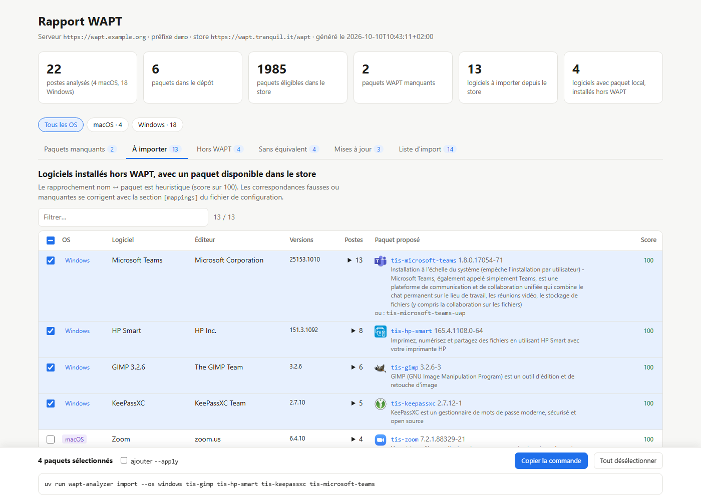

# wapt-analyzer

Outil en ligne de commande pour entretenir le dépôt de paquets d'un serveur [WAPT](https://www.wapt.fr). Il compare ce dépôt, le store public Tranquil IT et l'inventaire des postes, puis aide à combler les écarts.

Sources : [Gitea](https://git.k3nny.fr/k3nny/wapt-analyzer) (dépôt principal) · [GitHub](https://github.com/k3nnyfr/wapt-analyzer) (miroir).

| Commande | Rôle | Écrit sur le serveur ? |
|---|---|---|
| [`report`](#le-rapport) | Analyse le parc et produit un rapport : paquets manquants, logiciels installés hors WAPT, mises à jour disponibles | Non, lecture seule |
| [`import`](#importer-des-paquets-depuis-le-store) | Importe des paquets du store : vérification de la signature d'origine, renommage à votre préfixe, signature avec **votre** clé, upload | Oui, avec `--apply` |
| [`import --update`](#mettre-à-jour-les-paquets-du-dépôt) | Met à jour les paquets de votre dépôt pour lesquels le store propose une version plus récente | Oui, avec `--apply` |
| [`cleanup`](#nettoyer-le-dépôt) | Supprime les anciennes versions qu'aucun poste ne peut plus installer | Oui, avec `--apply` |
| [`report --notify`](#rapport-planifié-et-notifications) | Envoie le résumé du rapport par mail et/ou webhook, par exemple depuis cron | Non, lecture seule |

Les commandes qui modifient le dépôt fonctionnent **en simulation par défaut** : elles affichent leur plan et ne font rien tant que `--apply` n'est pas passé.

Un cycle d'entretien typique :

```bash
uv run wapt-analyzer report --json wapt-report.json          # 1. analyser, ouvrir wapt-report.html
uv run wapt-analyzer import --from-report wapt-report.json   # 2. vérifier le plan d'import…
uv run wapt-analyzer import --from-report wapt-report.json --apply   # … puis l'exécuter
uv run wapt-analyzer import --update --apply --cleanup       # 3. mettre à jour et nettoyer les anciennes versions
```

Ces exemples supposent le serveur, le compte et le préfixe renseignés dans le [fichier de configuration](INSTALL.md#fichier-de-configuration).

## Le rapport

`report` produit un rapport HTML autonome (avec export JSON/CSV optionnel) contenant :

| Onglet | Contenu |
|---|---|
| **Paquets manquants** | Paquets WAPT installés sur les postes mais absents du dépôt, quel que soit le préfixe (`tis-firefox` ≈ `tsi-firefox`), avec leur disponibilité dans le store |
| **À importer** | Logiciels installés hors WAPT pour lesquels un paquet existe dans le store |
| **Hors WAPT** | Logiciels installés hors WAPT alors qu'un paquet existe déjà dans le dépôt |
| **Sans équivalent** | Logiciels pour lesquels aucun paquet n'a été identifié |
| **Mises à jour** | Paquets du dépôt dont la version amont est plus ancienne que celle du store |
| **Liste d'import** | Liste consolidée des paquets du store à importer |

Le rapport fait le lien avec `import` : chaque paquet proposé (onglets paquets manquants, à importer, mises à jour, liste d'import) a une case à cocher, et une barre en bas de page affiche la commande `uv run wapt-analyzer import …` correspondant à la sélection, regroupée par OS, prête à copier (avec ou sans `--apply`). Les paquets réservés aux abonnés ne sont pas sélectionnables.



*Rapport généré par [`scripts/demo_report.py`](scripts/demo_report.py) à partir de postes et d'un dépôt fictifs.*

## Installation

Python 3.10 ou plus récent et [uv](https://docs.astral.sh/uv/) (le miroir GitHub `https://github.com/k3nnyfr/wapt-analyzer` fonctionne aussi) :

```bash
git clone https://git.k3nny.fr/k3nny/wapt-analyzer && cd wapt-analyzer
cp wapt-analyzer.example.toml wapt-analyzer.toml     # puis renseigner serveur, compte et préfixe
uv run wapt-analyzer report
```

Le guide d'installation, [INSTALL.md](INSTALL.md), détaille :
- l'installation depuis un clone ou en outil global (`uv tool install`), et l'agent WAPT nécessaire à `import` ;
- le [fichier de configuration](INSTALL.md#fichier-de-configuration) : emplacements, sections, ordre de priorité avec les variables d'environnement ;
- le stockage du [mot de passe du serveur](INSTALL.md#mot-de-passe-du-serveur-wapt) et de la [passphrase de la clé de signature](INSTALL.md#clé-de-signature-et-passphrase) : variables, fichiers `chmod 600`, cas de WSL.

## Utilisation

```bash
uv run wapt-analyzer report --server https://wapt.example.org --user admin --prefix tsi
```

Le mot de passe est lu depuis `$WAPT_PASSWORD` ou un fichier protégé, sinon demandé (voir [INSTALL.md](INSTALL.md#mot-de-passe-du-serveur-wapt)).

Options principales de `wapt-analyzer report` :

| Option | Rôle |
|---|---|
| `--server URL` | URL du serveur WAPT |
| `--user`, `--password-file` | Compte admin ; le fichier de mot de passe doit être en `chmod 600` |
| `--totp` | Code TOTP, si le compte exige la double authentification (sinon `$WAPT_TOTP` ou saisie) |
| `--client-certificate`, `--client-private-key` | Certificat client, si le serveur en exige un (voir [INSTALL.md](INSTALL.md#certificat-client)) |
| `--prefix` | Préfixe de vos paquets (ex. `tsi`) |
| `--repo-url`, `--store-url`, `--store-prefix` | Dépôt local (défaut `<server>/wapt`) et store (défaut Tranquil IT, préfixe `tis`) |
| `--os` | Familles d'OS analysées : `windows`, `macos`, `linux` (défaut : celles des postes) |
| `--arch`, `--maturity`, `--locale` | Filtres sur les paquets du store, valeurs séparées par des virgules |
| `--threshold` | Score minimal (0–100) du rapprochement logiciel ↔ paquet, 88 par défaut |
| `-o`, `--json`, `--csv-dir` | Sorties HTML, JSON et CSV |
| `--offline` | Réutilise les index et l'inventaire mis en cache lors du dernier passage |
| `--insecure`, `--ca-bundle` | Vérification TLS |
| `-v`, `-vv` | Verbosité |

### Configuration

Toutes les options peuvent être placées dans un fichier TOML (`./wapt-analyzer.toml`, `~/.config/wapt-analyzer/config.toml` ou `-c FICHIER`), et certaines dans des variables d'environnement. La ligne de commande l'emporte sur l'environnement, qui l'emporte sur le fichier. Voir [INSTALL.md](INSTALL.md#fichier-de-configuration) et [`wapt-analyzer.example.toml`](wapt-analyzer.example.toml).

### Ajuster le rapprochement

Le lien entre le nom d'un logiciel dans l'inventaire et un paquet est heuristique : nom normalisé (sans version, architecture ni langue), puis correspondance floue. La section `[mappings]` permet de corriger le résultat :

```toml
[mappings]
"^Microsoft Teams" = "microsoft-teams-uwp"   # force le paquet (nom sans préfixe)
"^ACME outil interne" = ""                    # ignore ce logiciel
```

Les **éditions** ne sont jamais mélangées. Un numéro qui identifie une édition (« Office 2016 », « Microsoft 365 », « Visual C++ v14 ») doit se retrouver dans le paquet proposé. Les versions à points, les architectures et les numéros de build ou d'update ne comptent pas comme des éditions. Si aucun paquet de la même édition n'existe, le logiciel est classé « sans équivalent » et le rapport liste les autres éditions disponibles. On peut alors en choisir une avec un mapping.

Un nom d'éditeur générique en tête (« Microsoft », « Adobe »…) est aussi essayé sans l'éditeur, car les noms du store l'omettent souvent : « Microsoft Office LTSC Professional Plus 2021 » est rapproché de « Office LTSC Professional Plus 2021 ».

`[matching] exclude` contient la liste des expressions régulières qui écartent du bruit (mises à jour KB, pilotes, runtimes…).

Les logiciels **sans équivalent** publiés par un constructeur (profil `oem` : HP, Epson, Canon, Intel, AMD, ASUS, Acer, Lenovo, Realtek…) sont **repliés** dans l'onglet « Sans équivalent ». Ils restent affichables avec une case à cocher. Le profil ne touche pas les logiciels pour lesquels un paquet existe : *Lenovo System Update* ou *Epson Scan 2* restent proposés à l'import. Pour le désactiver ou l'étendre :

```toml
[matching]
fold_profiles = []                       # défaut : ["oem"]
fold_publishers = ["^Bayo$", "^ACME"]    # éditeurs supplémentaires à replier
```

### Multi-OS (Windows, macOS, Linux)

L'analyse est faite par famille d'OS, déterminée à partir de l'OS du poste et du champ `target_os` des paquets. Un paquet `tsi-firefox` publié pour Windows ne couvre donc pas un Mac. Le store est filtré par architecture selon la famille (`[filters.architectures]`). Quand un logiciel n'a pas de paquet pour son OS mais en a un pour un autre, le rapport l'indique.

Sur macOS, l'inventaire est filtré par défaut : applications système (`/System/…`), reçus d'installation `pkgid:` et éditeur `apple`.

### Comment l'outil reconnaît un logiciel installé par WAPT

Un logiciel est considéré comme installé par WAPT dans deux cas :
- sa clé de désinstallation figure dans le champ `uninstall_key` d'un paquet installé sur le poste ;
- le paquet auquel il est rapproché est installé par WAPT sur ce poste. C'est le cas typique sur macOS, où les paquets ne déclarent en général pas de clé.

Les autres sont traités comme installés hors WAPT.

## Importer des paquets depuis le store

Trois façons de choisir les paquets à importer :

```bash
uv run wapt-analyzer import firefox-esr tis-keepassxc     # par nom, avec ou sans préfixe du store
uv run wapt-analyzer import --from-report wapt-report.json --only gimp,libreoffice-fresh   # candidats d'un rapport JSON
uv run wapt-analyzer import --update                      # paquets du dépôt en retard sur le store
```

Sans `--apply`, la commande affiche seulement le plan : paquets retenus, dépendances ajoutées, paquets ignorés et pourquoi, taille à télécharger. Avec `--apply`, elle demande confirmation (sauf `-y`) puis exécute :

```bash
uv run wapt-analyzer import firefox-esr --apply           # télécharge, vérifie, signe, envoie
```

Pour chaque paquet :

1. **Téléchargement** depuis le store, avec contrôle MD5 par rapport à l'index.
2. **Vérification** de la signature d'origine : fichiers et métadonnées (`--verify full`, par défaut) ou métadonnées seulement (`--verify control`). Voir [Source et confiance](#source-et-confiance).
3. **Renommage** au préfixe local : `tis-firefox` devient `tsi-firefox`, et les `depends` et `conflicts` suivent.
4. **Signature** avec votre certificat. La passphrase est demandée **une seule fois** : tous les paquets sont signés dans le même processus.
5. **Upload** sur le serveur (`api/v3/upload_packages`), en streaming pour les gros paquets.

Dans un terminal, chaque phase (téléchargement, signature, upload) affiche une barre de progression avec le paquet en cours, ainsi que le débit et le temps restant pour les transferts. Hors terminal (cron, redirection), seuls les messages de log sont écrits.

Comportement par défaut :
- les dépendances absentes de votre dépôt sont ajoutées au plan, sauf avec `--no-deps` ;
- les paquets déjà présents en version égale ou plus récente sont ignorés, sauf avec `--force` ;
- les paquets de l'agent lui-même (`waptupgrade`, `waptsetup`, `waptagent`, `waptserver`) ne sont jamais importés (`[import] exclude`) ;
- les paquets dont la licence contient `wapt_enterprise` ne sont téléchargeables qu'avec un abonnement. Ils sont signalés par un badge « Enterprise » dans le rapport et ignorés par `import`. Si vous avez un abonnement, mettez `[store] restricted_licences = []`.

Options principales de `wapt-analyzer import` :

| Option | Rôle |
|---|---|
| `PAQUET…` | Paquets à importer (`firefox` ou `tis-firefox`) ; avec `--update`, restreint la mise à jour à ces paquets |
| `--from-report JSON`, `--only` | Importe les candidats d'un rapport JSON, éventuellement filtrés |
| `--update` | Met à jour les paquets du dépôt en retard sur le store (voir ci-dessous) |
| `--apply`, `-y` | Exécute réellement l'import ; `-y` saute la confirmation |
| `--cleanup` | Après l'upload, supprime les versions remplacées par celles importées (voir [Nettoyer le dépôt](#nettoyer-le-dépôt)) |
| `--no-deps`, `--force` | Ignore les dépendances ; importe même si le dépôt a déjà la version |
| `--no-upload`, `--output-dir` | Signe sans envoyer ; dossier des paquets signés |
| `--certificate`, `--private-key`, `--key-password-file` | Clé de signature (voir plus bas) |
| `--set-maturity` | Maturité des paquets importés (défaut : celle du store) |
| `--verify`, `--trusted-cert`, `--trusted-fingerprint` | Vérification de la source (voir [Source et confiance](#source-et-confiance)) |
| `--wapt-python` | `waptpython` à utiliser (défaut : détection automatique) |

Les options de `report` concernant le serveur, le dépôt, le store et les filtres (`--server`, `--prefix`, `--store-url`, `--os`, `--arch`…) s'appliquent aussi.

### Mettre à jour les paquets du dépôt

```bash
uv run wapt-analyzer import --update                       # plan : paquets en retard sur le store
uv run wapt-analyzer import --update firefox chrome --apply
uv run wapt-analyzer import --update --apply --cleanup     # puis supprime les versions remplacées
```

`--update` reprend la liste de l'onglet « Mises à jour » du rapport : les paquets de votre dépôt pour lesquels le store propose une version plus récente. La comparaison se fait pour le même OS et la même architecture (un paquet local `all` accepte toutes les architectures). Elle porte sur la version complète, donc une nouvelle révision du paquet (`-110` → `-111`) compte aussi. Les noms passés en argument, ou via `--only`, restreignent la liste.

Les paquets mis à jour passent par les mêmes étapes qu'un import : vérification, renommage, signature avec votre clé, upload.

`[import] update_exclude` protège vos paquets maison qui portent le même nom qu'un paquet du store :

```toml
[import]
update_exclude = ["vcredist"]   # nom sans préfixe
```

### Signature

La signature s'appuie sur l'implémentation de référence de WAPT (`waptpackage.sign_package`, comme `wapt-signpackages`), exécutée par le `waptpython` d'un agent WAPT installé :
- `/opt/wapt` sous Linux ;
- `/Applications/wapt` sous macOS ;
- `C:\Program Files (x86)\wapt` sous Windows, y compris depuis WSL.

Le chemin est détecté automatiquement, ou fixé avec `--wapt-python`.

**Sous WSL avec l'agent Windows**, les téléchargements et les paquets signés sont placés sur le disque Windows (`%LOCALAPPDATA%\wapt-analyzer\import`). Les grosses écritures d'un programme Windows vers le partage `\\wsl.localhost\…` peuvent en effet se bloquer indéfiniment. Ce dossier peut être changé avec `[import] work_dir`, à condition de rester sous `/mnt/c/…`.

```toml
[signing]
certificate = "/chemin/vers/moncert.crt"
private_key = "/chemin/vers/moncert.pem"   # défaut : même nom en .pem
```

La passphrase est lue depuis `$WAPT_KEY_PASSWORD` ou un fichier `chmod 600`, sinon demandée une seule fois. Voir [INSTALL.md](INSTALL.md#clé-de-signature-et-passphrase) pour l'ordre de recherche et les précautions de stockage.

### Source et confiance

La source par défaut est le store public Tranquil IT, mais n'importe quel dépôt WAPT peut servir de source (dépôt interne, miroir…) via `--store-url` et `--store-prefix`.

Avant de signer un paquet avec votre clé, l'outil vérifie qu'il est authentique. Sont considérés comme dignes de confiance :

- les **certificats locaux** listés dans `trusted_certs` (fichiers ou dossiers), acceptés tels quels ;
- les certificats **fournis dans l'index de la source** (`ssl/*.crt`), uniquement si leur empreinte SHA-256 figure dans `trusted_fingerprints`.

Par défaut, seul le certificat Tranquil IT (`8c5127a7…`) est épinglé, et seulement quand la source est le store Tranquil IT. L'index de ce store contient aussi un certificat `CN=test`, qui n'est donc pas accepté.

Pour une autre source sans confiance configurée, l'import s'arrête avant de demander la moindre passphrase et affiche les certificats trouvés dans l'index, avec leur empreinte, pour qu'on puisse en épingler un en connaissance de cause.

```toml
[store]
url = "https://wapt.interne.lan/wapt"
prefix = "abc"
trusted_fingerprints = ["b4cbf9ee…"]          # certificat fourni dans l'index de la source
trusted_certs = ["/etc/wapt/ssl/interne.crt"]  # et/ou certificats locaux
```

En ligne de commande : `--trusted-fingerprint SHA256` et `--trusted-cert CHEMIN` (options répétables).

`--verify none` désactive toute vérification. À n'utiliser que si vous maîtrisez totalement la source : les paquets seront signés avec votre clé sans aucun contrôle.

## Nettoyer le dépôt

Après une mise à jour, les anciennes versions restent dans le dépôt. `cleanup` supprime celles qu'aucun poste ne peut plus installer :

```bash
uv run wapt-analyzer cleanup                    # simulation : affiche ce qui serait supprimé
uv run wapt-analyzer cleanup firefox --apply    # seulement les anciennes versions de tsi-firefox
uv run wapt-analyzer import --update --apply --cleanup   # mise à jour puis nettoyage dans la foulée
```

La simulation liste chaque version, son OS, son architecture, la version qui la remplace, et l'espace libéré. Les versions conservées malgré tout sont affichées avec leur raison (dépendance à version précise, exclusion, préfixe).

Avec `import --cleanup`, le nettoyage ne porte que sur les paquets qui viennent d'être envoyés, à partir de l'index du dépôt rechargé après l'upload. Il demande la même confirmation, sauf avec `-y`.
Les agents WAPT installent la version la plus élevée parmi celles qui correspondent à leur OS, leur architecture, leur locale, leur maturité et leur version d'OS. Une version n'est donc supprimée que si une version plus récente du même paquet la **couvre entièrement** :

- même maturité ;
- les mêmes OS (ou plus) ;
- une architecture compatible : `all` couvre `x64`, l'inverse non ;
- la même locale (ou `all`) ;
- une plage `min_os_version` / `max_os_version` qui inclut la sienne.

Exemple : si la nouvelle version d'un paquet exige Windows 10 et l'ancienne non, l'ancienne reste, car c'est la dernière installable sur un poste Windows 7.

Garde-fous :
- une version visée par une dépendance à version précise, comme `tsi-foo(=1.2-3)`, n'est pas supprimée ;
- seuls les paquets à votre préfixe sont concernés, sauf avec `--all-prefixes` ;
- `--keep N` conserve en plus les N versions précédentes, pour pouvoir revenir en arrière ;
- `[cleanup] exclude` protège des paquets ;
- les suppressions sont définitives et demandent une confirmation, sauf avec `-y`.

```toml
[cleanup]
keep = 1                      # garde aussi la version précédente
exclude = ["waptupgrade"]     # nom sans préfixe
```

| Option | Rôle |
|---|---|
| `PAQUET…` | Limite le nettoyage à ces paquets (`firefox` ou `tsi-firefox`) |
| `--apply`, `-y` | Supprime réellement ; `-y` saute la confirmation |
| `--keep N` | Conserve en plus les N versions précédentes |
| `--all-prefixes` | Traite aussi les paquets qui ne sont pas à votre préfixe |

## Rapport planifié et notifications

`report --notify` envoie un résumé du rapport aux destinations de la section `[notify]` :
- **par mail** (SMTP), avec le rapport HTML en pièce jointe ;
- **par webhook**, en JSON brut, au format Slack (compatible Mattermost, Rocket.Chat…) ou en carte Microsoft Teams (Workflows). On peut déclarer plusieurs webhooks.

Le résumé reprend les compteurs du rapport, puis les **nouveautés depuis le dernier envoi** : mises à jour disponibles, paquets manquants, logiciels à importer (dix par rubrique au plus).

```toml
[notify]
when = "changes"           # n'envoyer que s'il y a du nouveau (défaut : always)
report_url = "https://intranet.example.org/wapt-report.html"   # lien ajouté au message, facultatif

[notify.email]
smtp_host = "smtp.example.org"
user = "wapt-analyzer"
password_file = "~/.config/wapt-analyzer/smtp-password"
from = "wapt-analyzer@example.org"
to = ["admin@example.org"]

[[notify.webhook]]
format = "slack"
url_file = "~/.config/wapt-analyzer/webhook-url"
```

Avec `when = "changes"`, le premier envoi a toujours lieu. Les suivants n'ont lieu que si une entrée nouvelle apparaît. Si aucune destination n'a pu être jointe, l'état n'est pas mémorisé, et les mêmes nouveautés seront proposées la fois suivante.

Pour tester la configuration sans interroger le serveur : `uv run wapt-analyzer report --offline --notify`.

Pour planifier le rapport, avec cron ou un timer systemd, voir [INSTALL.md](INSTALL.md#rapport-planifié). `-q` / `--quiet` supprime toute sortie hors erreurs, pour que cron n'envoie pas de mail à chaque exécution.

| Option | Rôle |
|---|---|
| `--notify` | Envoie le résumé aux destinations de `[notify]` |
| `-q`, `--quiet` | N'affiche que les erreurs |

## Limites

- Le serveur WAPT ne conserve que l'état **actuel** des paquets sur chaque poste. Un paquet désinstallé disparaît de l'inventaire, et l'historique est donc partiel.
- L'authentification Kerberos n'est pas prise en charge : login et mot de passe, avec code TOTP et certificat client si le serveur les exige.
- Le code TOTP ne peut pas être fourni par une tâche planifiée : utilisez un compte sans MFA pour l'automatisation.

## Développement

```bash
uv run ruff check .
uv run pytest
uv run python scripts/demo_report.py -o demo-report.html   # rapport de démonstration, sans serveur
```

## Licence

[GPL-3.0-or-later](LICENSE), comme WAPT.
