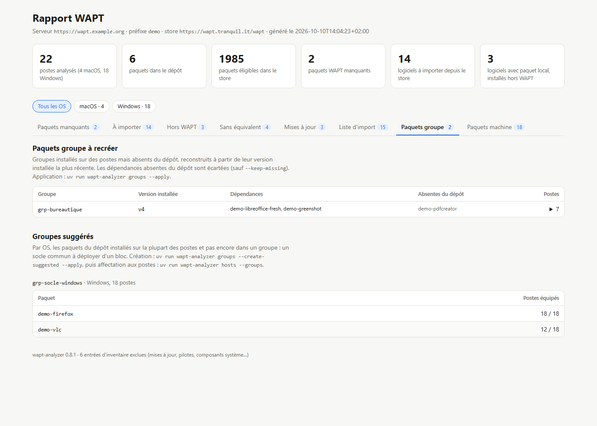

# Paquets groupe

[Documentation](README.md) · commande `groups`

Un paquet groupe (section `group`, par exemple `grp-base`) regroupe des paquets dans ses `depends`. On l'affecte à un poste en l'ajoutant à son [paquet machine](hosts.md), et le poste installe alors tout le groupe. `groups` recrée les groupes déployés sur les postes mais disparus du dépôt, et suggère des groupes à créer pour normaliser le parc.



```bash
uv run wapt-analyzer groups                                 # simulation : groupes à recréer, groupes suggérés
uv run wapt-analyzer groups --apply                         # recrée les groupes disparus
uv run wapt-analyzer groups --create-suggested -i --apply   # crée aussi les groupes suggérés, au choix
uv run wapt-analyzer hosts --groups --apply                 # puis affecte les groupes aux postes concernés
```

## Recréer les groupes disparus

Quand un groupe a été supprimé du dépôt, les postes qui l'avaient installé gardent sa dernière version, avec ses `depends`. L'inventaire du serveur la conserve, et `groups` s'en sert pour le reconstruire :

- la version installée la plus récente sert de modèle (dépendances, description, maturité…) ;
- les dépendances absentes du dépôt sont écartées et signalées, car les postes ne pourraient pas les installer. `--keep-missing` (ou `[groups] keep_missing = true`) les conserve ;
- un groupe reconstruit à l'identique garde son numéro de version. S'il a perdu des dépendances, la version est incrémentée.

Tant qu'un groupe installé n'est pas dans le dépôt, `hosts` ne l'ajoute pas aux paquets machine, et le signale.

## Groupes suggérés

Pour chaque OS, `groups` propose un groupe « socle commun » (`grp-socle-windows`, `grp-socle-macos`…) : les paquets du dépôt installés sur au moins 60 % des postes, et sur au moins 3. Sont écartés :
- les paquets déjà dans un groupe du dépôt ou dans un groupe à recréer ;
- les paquets tirés comme dépendance d'un autre paquet du socle.

`--create-suggested` crée ces groupes avec `--apply`. Ils ne sont encore affectés à aucun poste : `hosts --groups` les ajoute ensuite aux paquets machine des postes qui ont déjà la plupart de leurs paquets (80 % par défaut). Les paquets fournis par le groupe ne sont alors plus ajoutés un par un.

```toml
[groups]
keep_missing = false           # garder dans les groupes recréés les dépendances absentes du dépôt
suggest_share = 0.6            # socle suggéré : paquets présents sur au moins 60 % des postes…
suggest_min_hosts = 3          # … et sur au moins 3 postes
suggest_name = "grp-socle-{os}"
assign_share = 0.8             # hosts --groups : part des paquets du groupe déjà installés sur le poste
```

## Construction et envoi

Comme pour les paquets machine, le paquet groupe est construit à partir de son fichier `control` uniquement, comme dans la console WAPT. Il est signé avec votre clé (`[signing]`) puis envoyé dans le dépôt via `api/v3/upload_packages`.

| Option | Rôle |
|---|---|
| `GROUP…` | Limite aux groupes indiqués |
| `--create-suggested` | Crée aussi les groupes suggérés |
| `--keep-missing` | Garde dans les groupes recréés les dépendances absentes du dépôt |
| `-i`, `--interactive` | Choisit les groupes dans une liste à cocher |
| `--apply`, `-y` | Signe et envoie les groupes ; `-y` saute la confirmation |
| `--no-upload`, `--output-dir` | Signe sans envoyer ; dossier des paquets signés |
| `--certificate`, `--private-key`, `--key-password-file` | Clé de signature, comme pour `import` |
