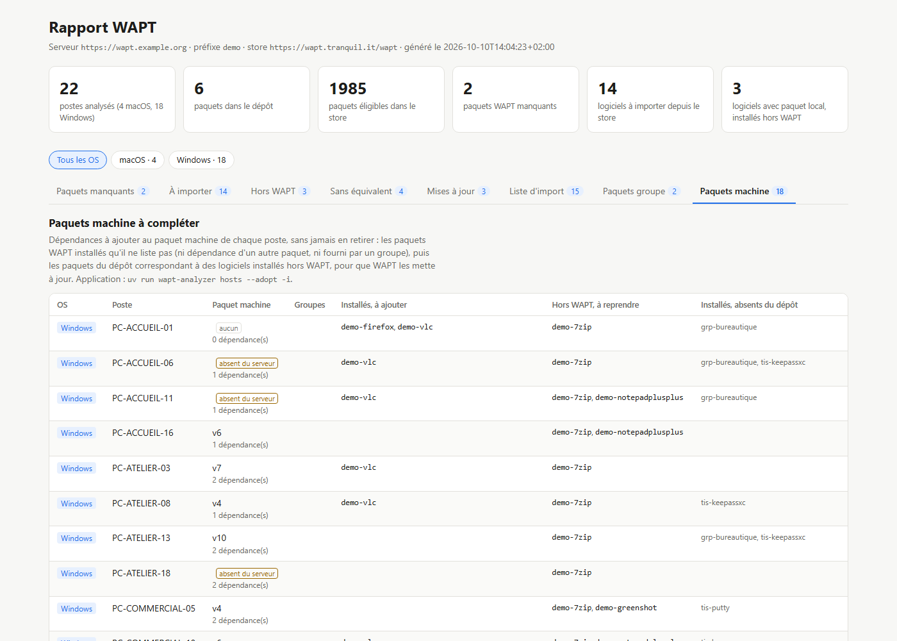

# Paquets machine

[Documentation](README.md) · commande `hosts`

Le paquet machine d'un poste (section `host`, nommé d'après son uuid) liste dans `depends` les paquets que le poste doit avoir. Avec le temps, il ne reflète plus la réalité : paquets installés à la main avec `wapt-get install`, logiciels installés hors WAPT, paquets machine disparus du serveur… `hosts` le remet en phase, **sans jamais retirer de dépendance**.



```bash
uv run wapt-analyzer hosts                          # simulation : ce qui serait ajouté, poste par poste
uv run wapt-analyzer hosts --adopt -i               # avec les logiciels hors WAPT, choix à la liste à cocher
uv run wapt-analyzer hosts pc-compta --apply        # un seul poste, signé et envoyé
```

Trois sortes d'ajouts :

1. **Groupes** : les paquets groupe installés sur le poste et présents dans le dépôt. Avec `--groups`, aussi les groupes du dépôt dont le poste a déjà la plupart des paquets (80 % par défaut, `[groups] assign_share`) : c'est ainsi qu'un groupe nouvellement créé (voir [Paquets groupe](groups.md)) est affecté aux postes. Un groupe installé mais absent du dépôt est signalé : recréez-le d'abord avec `groups`.
2. **Paquets installés** : les paquets WAPT installés sur le poste et présents dans le dépôt à votre préfixe, que le paquet machine ne liste pas. Sont écartés les paquets tirés comme dépendance d'un autre (`tsi-webview2` installé pour `tsi-teams`) et ceux fournis par un groupe installé ou ajouté. Un paquet installé sous le préfixe du store (`tis-keepassxc`) est remplacé par le vôtre (`tsi-keepassxc`). Les paquets installés mais absents du dépôt sont signalés.
3. **Logiciels hors WAPT** (`--adopt`) : les paquets du dépôt correspondant à des logiciels installés hors WAPT (onglet « Hors WAPT » du rapport). Une fois dans le paquet machine, WAPT installe son paquet par-dessus, puis le tient à jour : c'est ce qui permet de suivre les mises à jour des logiciels installés à la main. Pour un logiciel qui n'a de paquet que dans le store, importez-le d'abord (`import`), il sera proposé au passage suivant.

Les dépendances actuelles sont celles du paquet machine stocké sur le serveur, complétées par celles du paquet machine installé sur le poste. **Un paquet machine installé sur le poste mais absent du serveur est recréé**, même s'il n'y a rien à ajouter. Un poste sans paquet machine en reçoit un.

Le paquet machine est reconstruit comme le fait la console WAPT : uniquement le fichier `control`, avec ses attributs (description, architecture, maturité…) repris de l'existant, la version incrémentée et la signature avec votre clé (`[signing]`, comme `import`). Il est envoyé via `api/v3/upload_hosts`, qui le chiffre pour le poste si le serveur est configuré ainsi. Un paquet machine contenant un `setup.py` ou d'autres fichiers ne les conserverait pas : c'est rare, mais vérifiez-le pour vos postes particuliers.

```toml
[hosts]
exclude = ["waptupgrade"]     # paquets (sans préfixe) jamais ajoutés aux paquets machine
```

| Option | Rôle |
|---|---|
| `HOST…` | Limite aux postes indiqués (nom court, FQDN ou uuid) |
| `--adopt` | Ajoute aussi les paquets des logiciels installés hors WAPT |
| `--groups` | Ajoute aussi les groupes du dépôt dont le poste a déjà la plupart des paquets |
| `-i`, `--interactive` | Choisit les ajouts dans une liste à cocher |
| `--apply`, `-y` | Signe et envoie les paquets machine ; `-y` saute la confirmation |
| `--no-upload`, `--output-dir` | Signe sans envoyer, pour vérifier les paquets ; dossier des paquets signés |
| `--certificate`, `--private-key`, `--key-password-file` | Clé de signature, comme pour `import` |
