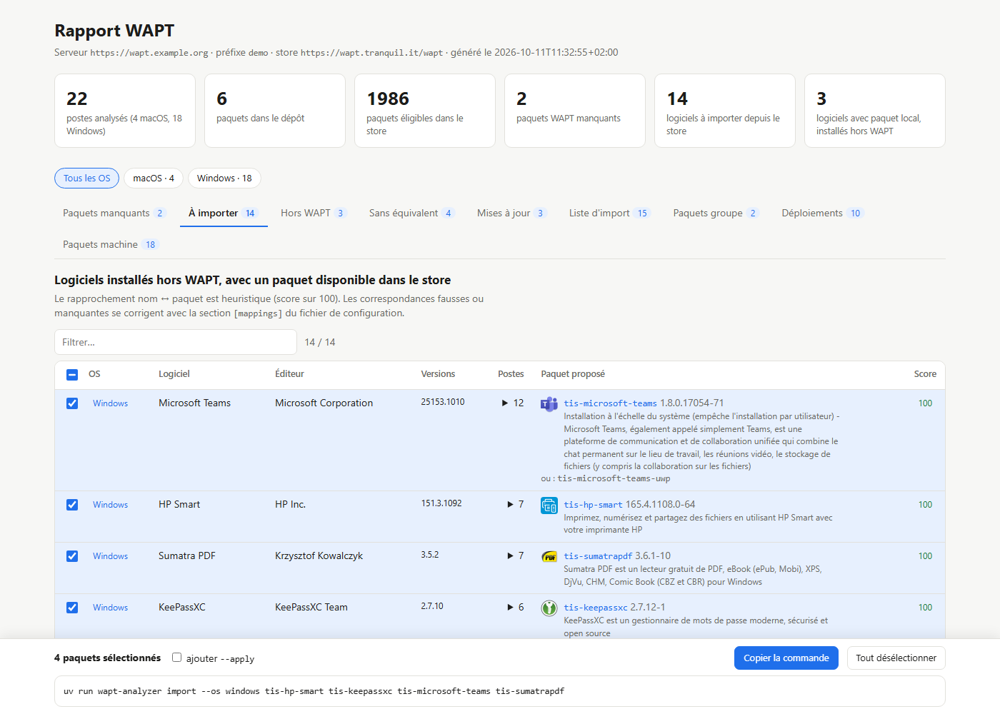
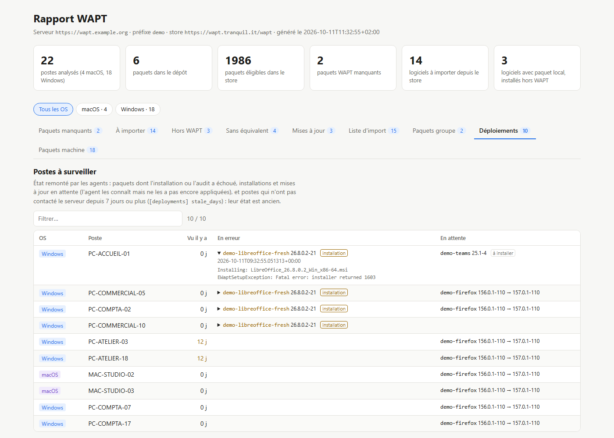

# Le rapport

[Documentation](README.md) · commande `report`

`report` produit un rapport HTML autonome (avec export JSON/CSV optionnel) contenant :

| Onglet | Contenu |
|---|---|
| **Paquets manquants** | Paquets WAPT installés sur les postes mais absents du dépôt, quel que soit le préfixe (`tis-firefox` ≈ `tsi-firefox`), avec leur disponibilité dans le store |
| **À importer** | Logiciels installés hors WAPT pour lesquels un paquet existe dans le store |
| **Hors WAPT** | Logiciels installés hors WAPT alors qu'un paquet existe déjà dans le dépôt |
| **Sans équivalent** | Logiciels pour lesquels aucun paquet n'a été identifié |
| **Mises à jour** | Paquets du dépôt dont la version amont est plus ancienne que celle du store |
| **Liste d'import** | Liste consolidée des paquets du store à importer |
| **Paquets groupe** | Groupes installés sur les postes mais absents du dépôt, groupes « socle commun » suggérés (voir [`groups`](groups.md)) |
| **Déploiements** | Paquets en erreur (installation ou audit), installations et mises à jour en attente, postes muets depuis plusieurs jours (voir [Suivi des déploiements](#suivi-des-déploiements)) |
| **Paquets machine** | Dépendances à ajouter au paquet machine de chaque poste (groupes, paquets installés, logiciels hors WAPT), paquets machine absents du serveur (voir [`hosts`](hosts.md)) |

Le rapport fait le lien avec `import` : chaque paquet proposé (onglets paquets manquants, à importer, mises à jour, liste d'import) a une case à cocher, et une barre en bas de page affiche la commande `uv run wapt-analyzer import …` correspondant à la sélection, regroupée par OS, prête à copier (avec ou sans `--apply`). Les paquets réservés aux abonnés ne sont pas sélectionnables.



*Rapport généré par [`scripts/demo_report.py`](../scripts/demo_report.py) à partir de postes et d'un dépôt fictifs.*

## Lancer le rapport

```bash
uv run wapt-analyzer report --server https://wapt.example.org --user admin --prefix tsi
```

Le mot de passe est lu depuis `$WAPT_PASSWORD` ou un fichier protégé, sinon demandé (voir [Authentification et secrets](secrets.md#mot-de-passe-du-serveur-wapt)).

Options principales de `wapt-analyzer report` :

| Option | Rôle |
|---|---|
| `--server URL` | URL du serveur WAPT |
| `--user`, `--password-file` | Compte admin ; le fichier de mot de passe doit être en `chmod 600` |
| `--totp` | Code TOTP, si le compte exige la double authentification (sinon `$WAPT_TOTP` ou saisie) |
| `--client-certificate`, `--client-private-key` | Certificat client, si le serveur en exige un (voir [Certificat client](secrets.md#certificat-client)) |
| `--prefix` | Préfixe de vos paquets (ex. `tsi`) |
| `--repo-url`, `--store-url`, `--store-prefix` | Dépôt local (défaut `<server>/wapt`) et store (défaut Tranquil IT, préfixe `tis`) |
| `--os` | Familles d'OS analysées : `windows`, `macos`, `linux` (défaut : celles des postes) |
| `--arch`, `--maturity`, `--locale` | Filtres sur les paquets du store, valeurs séparées par des virgules |
| `--threshold` | Score minimal (0–100) du rapprochement logiciel ↔ paquet, 88 par défaut |
| `-o`, `--json`, `--csv-dir` | Sorties HTML, JSON et CSV |
| `--offline` | Réutilise les index et l'inventaire mis en cache lors du dernier passage |
| `--insecure`, `--ca-bundle` | Vérification TLS |
| `-v`, `-vv` | Verbosité |

Toutes ces options peuvent être placées dans le [fichier de configuration](configuration.md).

## Ajuster le rapprochement

Le lien entre le nom d'un logiciel dans l'inventaire et un paquet est heuristique : nom normalisé (sans version, architecture ni langue), puis correspondance floue. La section `[mappings]` permet de corriger le résultat :

```toml
[mappings]
"^Microsoft Teams" = "microsoft-teams-uwp"   # force le paquet (nom sans préfixe)
"^ACME outil interne" = ""                    # ignore ce logiciel
```

Les **éditions** ne sont jamais mélangées. Un numéro qui identifie une édition (« Office 2016 », « Microsoft 365 », « Visual C++ v14 ») doit se retrouver dans le paquet proposé. Les versions à points, les architectures et les numéros de build ou d'update ne comptent pas comme des éditions. Si aucun paquet de la même édition n'existe, le logiciel est classé « sans équivalent » et le rapport liste les autres éditions disponibles. On peut alors en choisir une avec un mapping.

Un nom d'éditeur générique en tête (« Microsoft », « Adobe »…) est aussi essayé sans l'éditeur, car les noms du store l'omettent souvent : « Microsoft Office LTSC Professional Plus 2021 » est rapproché de « Office LTSC Professional Plus 2021 ».

`[matching] exclude` contient la liste des expressions régulières qui écartent du bruit (mises à jour KB, pilotes, runtimes…).

Les logiciels **sans équivalent** publiés par un constructeur (profil `oem` : HP, Epson, Canon, Intel, AMD, ASUS, Acer, Lenovo, Realtek…) sont **repliés** dans l'onglet « Sans équivalent ». Ils restent affichables avec une case à cocher. Le profil ne touche pas les logiciels pour lesquels un paquet existe : *Lenovo System Update* ou *Epson Scan 2* restent proposés à l'import. Pour le désactiver ou l'étendre :

```toml
[matching]
fold_profiles = []                       # défaut : ["oem"]
fold_publishers = ["^Bayo$", "^ACME"]    # éditeurs supplémentaires à replier
```

## Suivi des déploiements

L'onglet **Déploiements** montre si les paquets envoyés au serveur arrivent bien sur les postes. Il s'appuie sur l'état que chaque agent remonte au serveur, déjà présent dans l'inventaire : aucune requête supplémentaire.

| Colonne | Source |
|---|---|
| **En erreur** | Paquet dont l'installation a échoué (`install_status = ERROR`) ou dont l'audit signale une erreur ou un avertissement (`last_audit_status`). La fin de la sortie d'installation ou d'audit se déplie sous le paquet |
| **En attente** | Paquet que l'agent sait devoir installer, mettre à jour (`7zip 26.3 → 26.4`) ou désinstaller, mais qu'il n'a pas encore appliqué |
| **Vu il y a** | Jours écoulés depuis le dernier contact du poste ; au-delà de `[deployments] stale_days` (7 par défaut), son état est ancien et le poste est signalé |

Un second tableau regroupe les mêmes informations par paquet : un paquet en échec sur plusieurs postes pointe plutôt vers un problème du paquet lui-même. L'export CSV ajoute `deployments.csv`, et [`report --notify`](scheduling.md) signale les nouvelles erreurs. [`upgrade`](upgrade.md) demande aux postes concernés d'appliquer tout de suite leurs installations en attente.

```toml
[deployments]
stale_days = 14   # un poste muet depuis 14 jours est signalé
```



## Multi-OS (Windows, macOS, Linux)

L'analyse est faite par famille d'OS, déterminée à partir de l'OS du poste et du champ `target_os` des paquets. Un paquet `tsi-firefox` publié pour Windows ne couvre donc pas un Mac. Le store est filtré par architecture selon la famille (`[filters.architectures]`). Quand un logiciel n'a pas de paquet pour son OS mais en a un pour un autre, le rapport l'indique.

Sur macOS, l'inventaire est filtré par défaut : applications système (`/System/…`), reçus d'installation `pkgid:` et éditeur `apple`.

## Comment l'outil reconnaît un logiciel installé par WAPT

Un logiciel est considéré comme installé par WAPT dans deux cas :
- sa clé de désinstallation figure dans le champ `uninstall_key` d'un paquet installé sur le poste ;
- le paquet auquel il est rapproché est installé par WAPT sur ce poste. C'est le cas typique sur macOS, où les paquets ne déclarent en général pas de clé.

Les autres sont traités comme installés hors WAPT.

## Limites

- Le serveur WAPT ne conserve que l'état **actuel** des paquets sur chaque poste. Un paquet désinstallé disparaît de l'inventaire, et l'historique est donc partiel.
